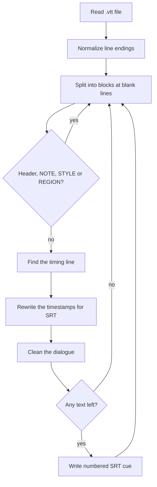

<div align="center">

# 🎞️ 2srtconverter

**Convert a whole folder of `.vtt` subtitle files to `.srt` in one go.**


</div>

---

## A note from the author

*I had one episode with almost 25 subtitle languages, and every one of them was a* `.vtt` *file. My video player wouldn't load* `WebVTT` *subtitles, and I wanted them inside a single* `.mkv`*, which means they had to be* `.srt` *first.*

*Converting 25 files by hand was not happening, so I wrote this. Point it at a folder, press Enter, and every* `.vtt` *comes out as an* `.srt` *with the same name.*

*I wrote the first version myself and then had it checked against a pile of odd VTT files. It turned out my version only handled the one file I tested it on, so it has since been reworked to handle the VTT variations that exist in the wild, not just the ones I happened to have.*

*For now I am uploading it in this folder but you can find the same file or usage in the* `sub_merger.py` *As at the end* `2srtconverter` *is a module of it, though that tool may go specific for specific task that's why I put the actual seperately here.*

---

## What it does

- Converts every `.vtt` file in a folder to `.srt`, keeping the file name (`episode.ar.vtt` becomes `episode.ar.srt`, so language tags in the name survive)
- Works with Windows and Linux line endings
- Skips the parts of VTT that aren't subtitles (header, `NOTE`, `STYLE`, `REGION` blocks)
- Renumbers the cues `1, 2, 3, ...`, whatever ids the VTT had
- Handles timestamps with or without hours, and drops the positioning settings that SRT doesn't support
- Keeps `<i>`, `<b>` and `<u>`, removes every other tag, and turns things like `&amp;` back into `&`
- Skips empty cues
- Reports every file that fails and carries on with the rest

## Quick start

No installs needed. It only uses Python's standard library.

```bash
python 2srtconverter.py
```

```text
2srtconverter: enter the path of a folder. It will get two subfolders:
  VTT - put your .vtt files here
  SRT - the converted .srt files appear here
Make sure the folder has writing permissions.
Press 'enter' when you are ready
Enter the full path of your folder: /home/me/episode05
Conversion successful: episode05.ar.vtt -> episode05.ar.srt
Conversion successful: episode05.en.vtt -> episode05.en.srt
Conversion failed: episode05.xx.vtt : no timing line in block: 'broken line'

Finished: 2 successful, 1 failed.
```

Steps:

1. Run the script and enter the path of any folder. A quoted path (drag and drop) works too.
2. The script creates `VTT` and `SRT` subfolders inside it, and moves all the files in the `VTT` sub-folder.
3. Shows the logs.
4. Collect the results from `SRT` sub-folder.

```text
your-folder/
├── VTT/   <- put .vtt files here
└── SRT/   <- converted .srt files appear here
```

## How it works



Timestamps are rewritten like this:

| VTT | SRT |
|---|---|
| `00:01:02.500 --> 00:01:04.000 align:start` | `00:01:02,500 --> 00:01:04,000` |
| `01:02.500 --> 01:04.000` (no hours) | `00:01:02,500 --> 00:01:04,000` |

## What happens to the text

| In the VTT | In the SRT |
|---|---|
| `<i>text</i>`, `<b>`, `<u>` | kept as they are |
| `<v Name>`, `<c.colour>`, timing tags like `<00:00:01.500>` | removed (the text inside stays) |
| `&amp;`, `&lt;` and similar | turned into `&`, `<` |
| a cue with no text | skipped |
| `NOTE` / `STYLE` / `REGION` blocks | skipped |

## Things to know

- **Files that can't be converted are reported, not hidden.** A file with no cues, a block with no timing line, or a file that isn't UTF-8 is listed as failed with the reason, and the other files are still converted.
- **One bad block rejects the whole file.** This is on purpose, so you never get an SRT that quietly lost some subtitles.
- **Existing `.srt` files with the same name in `SRT` are overwritten.**
- **Cues are not sorted.** If the VTT has overlapping or out-of-order cues, the SRT keeps them in the same order. mkvmerge and common players accept that.

## Known limitations

This is a small tool built for one job. Be aware of these:

- **Styling is lost.** Colours, positions, alignment and speaker names (`<v Name>`) are dropped, because SRT has no place for them. Only italic, bold and underline survive.
- **Only `.vtt` files directly inside the `VTT` folder are converted.** Subfolders are not searched.
- **UTF-8 only.** A file in another encoding fails with a decoding error. Convert it to UTF-8 first.
- **Interactive only.** There are no command-line arguments.
- **Timestamps are not adjusted.** The tool does not shift or fix timing, it only converts the format.

## Project layout

```text
2srtconverter.py   # the whole tool
```