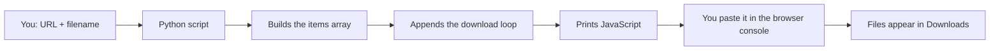

<div align="center">

# 🧰 JScode_string_generator

**Paste links and filenames in, get one ready-to-run JavaScript snippet out.**


</div>

---

## A note from the author

I am, by nature, a lazy person. Not the dramatic kind who gives up on things, but the kind who will happily spend an hour automating a task that takes five minutes, just to avoid doing it twice.

This tool is the result of exactly that. There was a **specific site** where I had a pile of PDFs to save, and doing it by hand, one file at a time, felt like a personal insult. So I wrote a template, a small script that asks me for a link and a filename, repeats until I'm done, and hands back a single block of JavaScript. I paste it into the browser console, press Enter, and the files land in my Downloads folder.

That's the whole story. No grand design, just laziness with a deadline.

> **Honest disclaimer:** this is a very small, very specific tool. It was built for one job on one site, and it may not be useful to you at all. It's here because I made it, I use it, and sharing it costs nothing.

---

## What it does

`JScode_string_generator.py` is a **template-based code generator**. It doesn't download anything itself. Instead it:

1. Asks you for a **URL** and a **filename**, over and over, until you stop.
2. Builds a JavaScript array of those `{ url, file }` pairs.
3. Appends a fixed download loop (the template).
4. Prints the finished code, ready to copy.

You then paste that code into your browser's developer console on the site, and the browser saves every file for you.

## Quick start

No installs needed, only Python 3.

```bash
python JScode_string_generator.py
```

Then:

1. **Enter the URL** of a file when prompted.
2. **Enter a filename.** `.pdf` is added automatically if you leave it off.
3. Repeat for as many files as you like.
4. Type **`x`** at the URL prompt when you're finished.
5. The screen clears and prints only the code between two `=` lines. Copy it from there.

### Example session

```text
Enter x in url to stop input
Enter url> https://example.com/files/doc1
Enter filename> Lecture 1
Enter url> https://example.com/files/doc2
Enter filename> Lecture 2.pdf
Enter url> x
```

### Example output

```javascript
const items = [
{ url: "https://example.com/files/doc1", file: "Lecture 1.pdf" },
{ url: "https://example.com/files/doc2", file: "Lecture 2.pdf" }
];

for (const item of items) {
fetch(item.url)
  .then(r => r.blob())
  .then(blob => {
    const a = document.createElement("a");
    a.href = URL.createObjectURL(blob);
    a.download = item.file;
    a.click();
    URL.revokeObjectURL(a.href);
  });
}
```

## Using the generated code

1. Open the **specific site** in your browser, in the same tab and session you normally use.
2. Open the developer console (`F12`, then the **Console** tab).
3. Paste the generated code and press **Enter**.
4. Your files start saving to your Downloads folder.

If your browser asks whether to allow multiple downloads, say yes.

> 💡 Run the code from a page on the site itself. That way the requests go out the same way your browser's normal ones do, with your existing session.

## How it works



The download loop is the fixed template: for each item it fetches the URL, turns the response into a blob, and triggers a browser download under the filename you chose.

## Known quirks

- **Stopping with no entries generates nothing.** If you type `x` before adding a file, the script says so and exits instead of printing code.
- **Quotes and backslashes are escaped for you**, so odd characters in URLs or filenames won't break the generated JavaScript.
- **It only generates code.** If the site changes how it works, the snippet may stop working and need adjusting.
- **Downloads fire all at once.** Large batches may be throttled or blocked by the browser.

## Is it useful?

Probably not for most people. It's a convenience script for a narrow situation, and I'm sharing it mostly as a small example of how far a little laziness can go.

## Responsible use

Only download files you have the right to access and save. Respect the terms of use of any site you work with and the laws where you live. You are responsible for how you use this tool.

## Project layout

```text
JScode_string_generator.py   # the whole tool: prompts, template, output
```