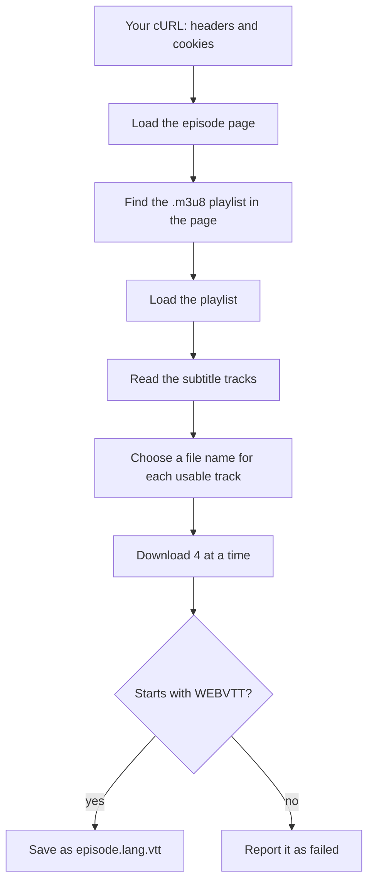

<div align="center">

# 🎞️ hsub_downloader

**Download every subtitle track of one episode from a very specific streaming site, in one go.**


</div>

---

## A note from the author

I archive things, and my archive has an after-hours shelf too. For that shelf I found a funny split between two sites: one of them has the **clean picture quality**, and the other, a very particular one I'll just call *the Sanctuary*, has **far more subtitle languages**. So the video comes from one place and the subtitles come from the other.

The catch is that the player only lets you *watch* the subtitles. It doesn't let you *save* them. I used to dig the links out of a network recording by hand, episode after episode, and then download them one by one.

I'm a lazy person, and I'm the kind of lazy that works hard on small problems. A job that looks like five minutes of clicking turns into a long, error-filled grind once you repeat it for every episode, because humans are bad at doing the same fiddly thing 25 times without slipping. So I wrote this. You give it the episode page, it gives you all the subtitle files.

It does one thing, for one site. It isn't clever. It just does that one thing for me every time.

---

## What it does

- Opens the episode page using **your own browser session** (a "Copy as cURL" from your browser)
- Finds the video's playlist in the page and reads the list of subtitle tracks from it
- Downloads every usable track, **4 at a time**, with a live progress panel (one row per file, plus a **Total** row)
- Saves each one as `<episode>.<lang>.vtt`, so the language tag stays in the file name
- Checks that each downloaded file really is a WebVTT subtitle, and not an error page
- Can **continue after a stop**: the cURL is kept in a small file until every subtitle is on disk
- Tells you in plain words what went wrong, and what to do about it
- Colours what you type, and makes the links and folders it prints clickable (if your terminal supports it)

It does **not** download the video, log in for you, or touch the ad or the player. It only reads the page you already opened in your own browser.

## Requirements

- Python **3.10 or newer**
- Two libraries:

```bash
pip install curl_cffi rich
```

- A **Firefox-based browser** (Zen or Firefox) with the episode page open. The cURL format it knows how to read is the one these browsers produce.

## Quick start

```bash
python hsub_downloader.py
```

Or give it the link up front:

```bash
python hsub_downloader.py --url "https://sanctuary.example/watch/some-series/episode-4/"
```

A typical first run looks like this:

```text
────────────── hsub_downloader.py ──────────────
Show the guide? [y/N] n
Episode page link: https://sanctuary.example/watch/some-series/episode-4/
Folder to save the subtitles into
  [/home/me/Downloads/hsub_downloads/subtitles/some-series episode-4] >
Folder to keep the saved cURL file in
  [/home/me/Downloads/hsub_downloads/cookies] >
Show how to copy the cURL? [Y/n] n
[INFO   ] : Paste the cURL now:
curl 'https://sanctuary.example/watch/some-series/episode-4/' -H 'User-Agent: ...' ...
[OK     ] : cURL saved: /home/me/Downloads/hsub_downloads/cookies/some-series episode-4_curl.txt
[INFO   ] : Found 25 subtitle track(s), 25 usable.
╭─ Downloads ───────────────────────────────────────────────────────────────────────╮
│╭─────────────────────────────────────────────────────────────────────────────────╮│
││ ✓ some-series-episode-4.ar.vtt ━━━━━━━━━━━━━━━━━━━━  100%   1.7/1.7 kB  0:00:00 ││
││ ⠋ some-series-episode-4.en.vtt ━━━━━━━━━━╸━━━━━━━━━   55%   0.9/1.7 kB  0:00:01 ││
││ ⠋                        Total ━━━━━╸━━━━━━━━━━━━━━   28%  7/25                 ││
│╰─────────────────────────────────────────────────────────────────────────────────╯│
╰───────────────────────────────────────────────────────────────────────────────────╯
[INFO   ] : Saved 25, already there 0, failed 0.
[INFO   ] : Subtitles folder: /home/me/Downloads/hsub_downloads/subtitles/some-series episode-4
[OK     ] : Every subtitle file is on disk. The saved cURL file was deleted.
```

Press Enter at the two folder questions to accept the defaults.

## The progress panel

While the files download, a rounded double-border panel shows one row per running file and a **Total** row (`7/25`) at the bottom. That Total row is the real progress. Each file row is only that one file, and these files are tiny, so they often fill up and vanish within a moment.

Each row has: a spinner (a tick when done), the file name, a bar, a percentage, the size, the time left and the speed. A `?` as the size means the server didn't say how big the file is.

- **It fills your terminal's width.** Names get the room first (up to the longest name), then the bar (never more than 100 characters), and whatever is left is spread evenly between the columns, so the rows stay lined up.
- **A long list keeps growing** instead of being cut with `...`.
- **Narrow terminals work down to about 70 columns.** The names shrink first (and are shortened with `...`), then the bar.
- The layout is worked out once, when the downloads start. Resizing the window mid-download won't re-flow it.
- If the list is taller than your terminal, the rows that scrolled off the top can't be redrawn, so the live view may look repeated. The finished list is correct.

## Clickable links and folders

The URLs and folder paths printed in the messages are real terminal links (OSC 8). Ctrl+click (or just click, depending on the terminal) opens them. This depends on your terminal: Konsole and Kitty support it, and a terminal that doesn't will just show plain text.

What you type at the questions is shown in a different colour. This is skipped automatically when the output isn't a terminal (for example when piped to a file).

## How to copy the cURL

The script can show these steps itself (answer **Y** to "Show how to copy the cURL?").

1. Open the episode page in your browser, then press **F12** to open the dev tools.
2. Open the **Network** tab (look under `>>` if you can't see it) and **reload the page**. Make sure no filter is active.
3. Find the row whose File is the episode's path, with Initiator `Document` and Type `html`.
4. Right-click it, then **Copy Value**, then **Copy as cURL** (**POSIX**). On Windows the browser may offer **Copy as cURL (Windows)**; don't use it. Only the POSIX format (single quotes, lines ending in `\`) is accepted, and the Windows one (`curl.exe` with `^` characters) is rejected as "not a cURL command".
5. Paste it into the terminal when the script asks. A multi-line paste is fine.

If the pasted text isn't a usable cURL command, the script says so and asks again. The screen is cleared before and after the paste (not when `--debug` is on), so the long pasted text doesn't stay in front of you.

## Options

| Option | What it does |
|---|---|
| `--url LINK` | Episode page link. If left out, you are asked for it. |
| `--browser NAME` | The browser the page is open in (`zen` or `firefox`). If it is right, the browser question in the cURL guide is skipped. If it is wrong, you get a warning and are asked as usual. |
| `--debug` | Shows extra detail: the page status, the playlist link, and the header and cookie **names** (never their values). |
| `--no-guide` | Skips the "Show the guide?" and "Show how to copy the cURL?" questions. |

## How it works



1. **The page.** The request is sent with the headers and cookies from your cURL, and it is made to look like a Firefox browser (via `curl_cffi`), because the site checks who is asking.
2. **The playlist.** The page contains a link to the video's `.m3u8` playlist. The script looks in three places, from the most reliable to the least: the page's JSON-LD data, then the `<source>` tag, then any `.m3u8` link anywhere in the page.
3. **The tracks.** The playlist lists each subtitle track with a language code, a name and a link. Those links are relative, so the script completes them from the playlist's own address.
4. **The download.** Each file is first written as `<name>.part`, checked, and only then renamed. A half-downloaded file never looks like a finished one.

## What gets saved

```text
hsub_downloads/
├── subtitles/
│   └── some-series episode-4/
│       ├── some-series-episode-4.ar.vtt
│       ├── some-series-episode-4.en.vtt
│       └── ...
└── cookies/
    └── some-series episode-4_curl.txt     <- exists only while a run is unfinished
```

The language tag always sits just before `.vtt`. That is on purpose, so later tools can read the language from the file name.

A track is **skipped, with a warning**, when it:

- has no language tag,
- has the **same language tag** as an earlier track (it never overwrites a file),
- isn't a plain `.vtt` link (segmented subtitles aren't supported).

Characters in a language tag that aren't letters or digits become `_`, so a tag like `zh-Hans` is saved as `zh_Hans`.

## Stopping and continuing

- The pasted cURL is saved as `<episode>_curl.txt` in the cookies folder, with private permissions, because it holds live cookies.
- If a run is stopped (Ctrl+C) or some files fail, **the cURL file is kept**. Run the script again and it reuses it.
- Files that are already on disk are skipped and reported as "already there". Only the missing ones are downloaded.
- The cURL file is deleted **only after every subtitle file is on disk**.
- If the saved cURL has expired and you get an HTTP 403, delete that file and run again to paste a fresh one.
- The script checks that the cURL belongs to the link you gave. If it is for another page, it refuses and tells you.

Exit codes: `0` everything saved, `1` an error or missing files, `130` stopped by you.

## Your cookies stay with the site

The cookies from your cURL are sent **only to the site itself**. The playlist and the subtitle files live on a different server, and that server only receives a User-Agent and a Referer. Nothing else leaves. Also I noticed the cookies get expired after 30 minutes.

## Known limitations

This is a small tool built for one job, and it shows. Be aware of these:

- **One site.** It is built around how that site lays out its pages. It looks in three common places for the playlist, so a similar site might work, but nothing is promised.
- **One episode per run.** There is no batch mode yet.
- **Firefox-based browsers only** (Zen, Firefox). Chromium's cURL format isn't supported yet.
- **The cURL expires.** Browser checks hand out cookies that don't last forever, so after a while you need to copy a fresh one.
- **Plain `.vtt` tracks only.** Subtitles split into many segments are skipped.
- **Subtitles only.** The video is not downloaded.
- **Developed on Arch Linux. Also runs on Windows (Powershell)** Not tested on macOS.
- **Needs a terminal with colour.** The panel and the link support assume a normal modern terminal. Below about 70 columns the panel gets cramped.

Use it only on pages you can already open normally in your own browser.

## Project layout

```text
hsub_downloader.py   # the whole tool
```