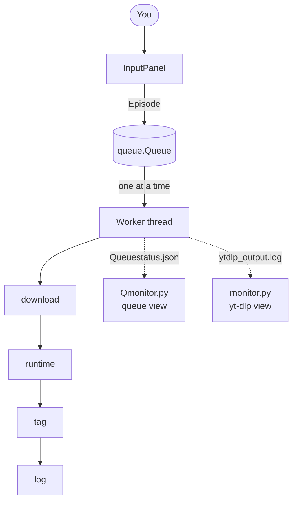

<div align="center">

# 📺 nonfondownloader

**A queue-driven episode downloader, tagger, and logger built on yt-dlp and MKVToolNix.**


</div>

---

> ## 🚀 This project has a successor: **Epidex**
>
> `nonfondownloader` is the **predecessor of Epidex**. It is kept here as the original, single-purpose version of the idea. For a better, more capable experience, use **Epidex**:
>
> 👉 Get **[Epidex](https://github.com/AyanDaw/epidex)**

---

## What is it?

nonfondownloader started life as a personal tool for building a clean, offline archive of a Bengali TV series, one episode at a time. You feed it a YouTube link and a description for each episode; it does everything else: fetches the official episode title, downloads the video, names the file properly, reads its runtime, scrubs junk metadata, labels the audio track, and records everything in a log.

While one episode downloads in the background, you can already be typing in the next one.

## Features

- **Official metadata from TMDB**: episode titles are pulled for the whole season in a single API call and cached locally (`metadata.json`), with a safety backup if a cache write fails.
- **Producer/consumer queue**: an input panel keeps accepting episodes while a single background worker downloads them one by one (deliberately not in parallel, to stay friendly to YouTube rate limits and RAM).
- **Smart backpressure**: input pauses when the queue is completely full and resumes only once two slots free up (hysteresis, so it doesn't flicker).
- **Clean MKV output**: H.264 (`avc1`) video + best audio, merged into `.mkv`.
- **Automatic tagging**: strips all global and per-track tags, clears the title, and sets the first audio track to language `ben` with the name `[ বাংলা (Bengali) ]` via `mkvpropedit`.
- **Automatic runtime**: reads the real duration with `mkvmerge -J` and rounds up to the next whole minute.
- **Tidy filenames**: `Series S01E005 Title.mkv`, sanitized for Windows-illegal characters.
- **Live dashboards**: two companion windows show raw `yt-dlp` progress and the current/upcoming queue in real time.
- **Personal records**: `log.txt` keeps `<episode> <runtime> <description>` for every entry; `links.txt` doubles as a repair worklist, flagging failed downloads with `NOT SUCCESSFUL!!`.
- **Graceful shutdown**: quitting never kills a download midway; the program waits for the queue to drain, then closes the monitors through a `STOP_MONITORS` flag file.
- **Friendly dependency checks**: missing Python packages or tools produce an actionable error instead of a traceback.

## How it works



## Requirements

| Requirement | Notes |
|---|---|
| **Python 3.12+** | Uses newer f-string syntax |
| `requests`, `python-dotenv`, `rich` | `pip install requests python-dotenv rich` |
| [`yt-dlp`](https://github.com/yt-dlp/yt-dlp) | On `PATH` or set in `.env` |
| [`deno`](https://deno.com) | JS runtime used by yt-dlp |
| [`MKVToolNix`](https://mkvtoolnix.download) | Provides `mkvmerge` and `mkvpropedit` |
| [`Firefox`](https://www.firefox.com) | Cookies are read from Firefox (`--cookies-from-browser firefox`) |
| [TMDB API key](https://www.themoviedb.org/settings/api) | Free |

## Setup

1. **Clone and install**
   ```bash
   git clone "https://github.com/AyanDaw/selfmade-tools"
   cd selfmade-tools/nonfondownloader
   pip install requests python-dotenv rich
   ```

2. **Create a `.env` file** next to `nonfondownloader.py`:
   ```env
   TMDB_API_KEY=your_tmdb_api_key
   SERIES=Your Series Name
   SERIES_ID=12345        # TMDB series id (from the show's TMDB URL)
   SEASON=1

   # Optional: only needed if the tool isn't on your PATH
   # YT_DLP_PATH=
   # DENO_PATH=
   # MKVMERGE_PATH=
   # MKVPROPEDIT_PATH=
   ```

   > ⚠️ Never commit `.env`. It contains your API key. Add it to `.gitignore`.

3. **Run it**
   ```bash
   python nonfondownloader.py
   ```

## Usage

1. If a cached `metadata.json` exists, choose to reuse it or fetch fresh data.
2. Enter the **starting episode number**.
3. Two monitor windows open automatically.
4. For each episode, the tool shows its title. Then:
   - paste the **YouTube share link** (or type `quit` to finish),
   - paste the **description** you want logged.
5. The episode is queued and the next prompt appears immediately.
6. When you quit, leave the window open until it prints **"Now you can close"**.

If TMDB has no title for an episode, you can skip it (it is logged as `SKIPPED`) or exit.

### Output files

| File | Purpose |
|---|---|
| `Series SxxEyyy Title.mkv` | The tagged episode |
| `log.txt` | Personal record: episode, runtime, description (written even if the download failed) |
| `links.txt` | Source URLs; failed downloads are marked for manual repair |
| `metadata.json` | Cached TMDB season data |
| `ytdlp_output.log` | Raw yt-dlp output, shown by `monitor.py` |
| `Queuestatus.json` | Live queue snapshot, shown by `Qmonitor.py` |

## Project layout

```
nonfondownloader.py   # main program: queue, input panel, downloader, tagger
monitor.py            # live yt-dlp output window
Qmonitor.py           # live queue status window
.env                  # your configuration (not committed)
```

## Platform notes

- Companion windows open as **Windows Terminal tabs** when `wt` is available, or a new console window otherwise on Windows.
- **Windows** is the supported platform for this version.
- **Linux** is untested. The core download, tagging and queue logic may work, but the monitor windows are only built to open on Windows.
- **macOS** is not supported.
- The audio tag and name are currently fixed to Bengali, and the series and season come from `.env` by design. Edit `scrub_and_tag()` if you want a different language.

## Troubleshooting

| Problem | Fix |
|---|---|
| `ERROR: '<tool>' not found on PATH` | Install it, add it to `PATH`, or set its `*_PATH` key in `.env` |
| yt-dlp fails with cookie or sign-in errors | Make sure you're signed in to YouTube in Firefox |
| Link logged as `NOT SUCCESSFUL!!` | Check `ytdlp_output.log` for the cause, then retry that link manually |
| No `avc1` (H.264) format available | The format selector in `download()` only accepts H.264, so widen the `-f` string |
| Episode title is `None` | TMDB has no entry for it, so skip it and download manually |

## Limitations

- Downloads are sequential by design.
- Built for one series/season per run.
- Requires you to supply the YouTube link and description for each episode manually.

These are the exact things the successor improves on.

## Move on to Epidex

nonfondownloader did its job and taught a lot along the way, but **Epidex** is where active development lives, with a more polished and capable experience.

👉 Try **[`Epidex`](https://github.com/AyanDaw/epidex)**

## Disclaimer

This tool is intended for personal archival of content you are entitled to download. You are responsible for complying with YouTube's Terms of Service and the laws in your region.