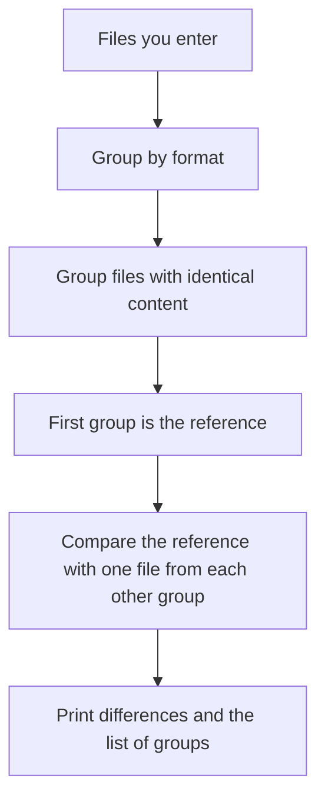

<div align="center">

# 🔍 sub-copy-checker

**Compare copies of the same subtitle file and see exactly where they differ, down to the character.**


</div>

---

## A note from the author

I archive things and I run a home lab, and those two hobbies have a habit of producing the same problem: **too many copies of the same file**.

During one particular series, I ended up with several subtitle files in the *same language* for the *same episode*. They were all named almost the same, they all looked almost the same, and I had no way of telling them apart. Opening them side by side and reading line by line was not an option. I needed a computer to do the staring for me.

So I built this.

Yes, I know that today I could point `diff` or Git at the problem, or paste both files into an AI and ask what's different. But back then I didn't use Git, and I didn't even know where to begin with it. And handing full subtitle files to an AI just to learn that one comma moved felt like burning tokens for no reason. A small script that runs in a second, offline, for free, was the better answer for me.

It's not clever. It's just honest: it tells me what's different and where, so I can decide which copy to keep.

*Update:* it started out as an SRT-only, two-files-at-a-time tool called `srt-copy-checker`. Since then I've taught it more subtitle formats and made it check as many files as I throw at it, so I renamed it to `sub_copy_checker` to match.

---

## What it does

Give it two or more subtitle files. It groups them by format, lines the subtitles up by content, and reports every difference:

- **Subtitle numbers** that don't match
- **Timestamps** that don't match
- **Dialogue** that doesn't match, with the exact character, its Unicode code point, and a caret pointing at the first difference
- **Missing or extra subtitles**, reported as a single difference instead of shifting everything after them
- **Style and position settings** that differ (ASS/SSA)
- **Anything it couldn't parse**, so nothing is ignored silently

With several files, it also sorts them into **groups of identical copies**, so you can see at a glance which files are the same and which are the odd ones out.

## Supported formats

| Extension | Format | What is compared |
|---|---|---|
| `.srt` | SubRip | number, timestamp, dialogue |
| `.vtt` | WebVTT | identifier (if any), timestamp line with cue settings, dialogue |
| `.ass` | Advanced SubStation Alpha | timing, dialogue, and each event's style, layer, margins, name and effect |
| `.ssa` | SubStation Alpha | same as `.ass` |
| `.sub` | MicroDVD (text, frame based) | frame timing, dialogue |
| `.sbv` | YouTube captions | timing, dialogue |

**Files are only ever compared with files of the same format.** An `.srt` is never compared with a `.vtt`, and `.ass` and `.ssa` count as different formats.

Each format has its own parser, and a small table routes every file to the right one. Adding a format means writing one parser function and one line in that table.

## Quick start

No installs needed. It only uses Python's standard library.

```bash
python sub_copy_checker.py
```

Enter one file path per line, then type `done` to start checking:

```text
File 1 (or 'done')> ep05_copy1.srt
  + added ep05_copy1.srt  [.srt | utf-8-sig | 140 subtitles]
File 2 (or 'done')> ep05_copy2.srt
  + added ep05_copy2.srt  [.srt | utf-8-sig | 140 subtitles]
File 3 (or 'done')> ep05_copy3.srt
  + added ep05_copy3.srt  [.srt | utf-8-sig | 139 subtitles]
File 4 (or 'done')> done
```

Tips:

- **Drag and drop works.** Paths wrapped in quotes are cleaned up, and several quoted paths on one line are split apart.
- Mix formats freely. Each format is checked on its own.
- A file that can't be read is skipped with a reason, and the rest carry on.

## How multiple files are checked



1. Files are grouped by format.
2. Within a format, files with exactly the same content are grouped together.
3. The first file you entered is the **reference**.
4. One file from every other group is compared with the reference in detail.
5. At the end you get the list of groups.

## Example output

```text
############ .srt files (3) ############
Reference file: ep05_copy1.srt

----------------------------------------------------------------------
File1 = ep05_copy1.srt
File2 = ep05_copy3.srt

=== File1 #2 / File2 #3  [00:00:03,000 --> 00:00:04,000] ===
Subtitle number differs
 File1: 2
 File2: 3

Dialogue differs (line 1)
 File1: I can't do this
 File2: I cant do this
First difference at character 6

File1:
I can't do this
     ^
Character: "'" U+0027 APOSTROPHE

File2:
I cant do this
     ^
Character: 't' U+0074 LATIN SMALL LETTER T

Extra in File2: #2 [00:00:02,500 --> 00:00:02,900] Inserted

========== SUMMARY ==========
Subtitles in File1 / File2 : 3 / 4
Matched exactly : 2
Only in File1 (missing in File2) : 0
Only in File2 (extra) : 1
...
Files are NOT identical.

======================================================================
GROUPS of identical .srt files
Group 1 (2 file(s)): ep05_copy1.srt, ep05_copy2.srt
Group 2 (1 file(s)): ep05_copy3.srt
```

Only the differences are printed. Matching subtitles stay quiet.

## What "identical" means

Files are identical **as parsed subtitles**. These things are deliberately ignored:

- A UTF-8 BOM at the start of the file
- Windows (`CRLF`) vs Linux (`LF`) line endings
- Empty lines between blocks
- The file's encoding, as long as the decoded text is the same

When files have identical content but different raw bytes, the report says so, so you know it wasn't a byte-for-byte copy.

Encodings are detected automatically: UTF-8 (with or without BOM), UTF-16, then Windows-1252, with Latin-1 as a last resort.

## Reading the differences

- **Code points are shown for every differing character.** This exposes differences you can't see, such as zero-width joiners, non-breaking spaces, or look-alike characters.
- **Unicode normalization is detected.** Text that looks identical but is encoded differently (common in Bengali and other Indic scripts) is called out with a note.
- **The caret is approximate.** It is placed by display width, but terminals render some scripts in ways it can't predict. The character and code point shown below it are the reliable part.

## Known limitations

This is a small tool built for one job. Be aware of these:

- **Only the reference is compared in detail.** If two non-reference groups differ from each other, you'll see them listed as separate groups, but not diffed against each other. Run the tool again on just those two files for the details.
- **Heavily edited subtitles may be reported as one missing plus one extra** instead of a single edit, when both the text and the timing changed a lot.
- **ASS/SSA:** only the `Dialogue:` events are compared. The script info, style definitions and commented-out lines are not. For WebVTT, `NOTE`, `STYLE` and `REGION` blocks are ignored.
- **`.sub` means MicroDVD text subtitles.** Image-based VobSub (`.sub` with `.idx`) is rejected with a clear message.
- **The file extension decides the format.** A mislabeled file will be rejected or reported as unparseable.
- **Encodings beyond UTF-8, UTF-16 and Windows-1252 may be decoded wrongly.** If text looks garbled, convert the file to UTF-8 first.
- **Interactive only.** There are no command-line arguments.

## Project layout

```text
sub_copy_checker.py   # the whole tool: parsers, comparer, report
```